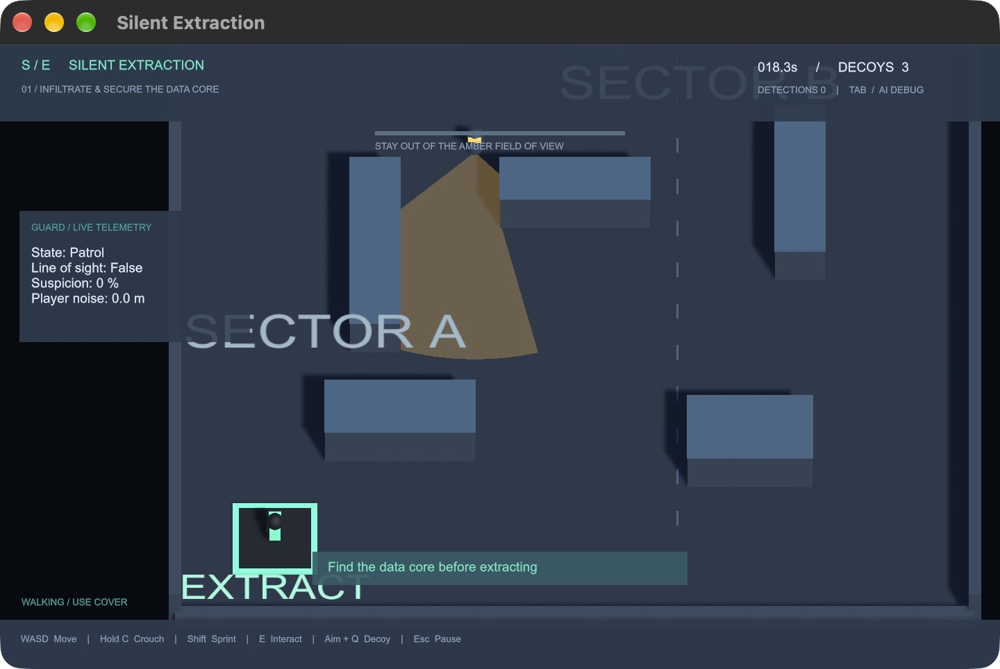

# Silent Extraction

A small 3D stealth prototype built in Unity 6.6 and C#. Infiltrate a facility, retrieve its data core, and return to the extraction pad while evading a patrol guard.

**Author:** Guanrui (Gary) Jiang · [LinkedIn](https://www.linkedin.com/in/guanrui-jiang-ab1393251/)

## Play

Open `Builds/SilentExtraction.app` on macOS after building, or open the project with Unity **6000.6.5f1**, load `Assets/SilentExtraction/Generated/Facility.unity`, and press Play. Press Enter to start.

| Input | Action |
| --- | --- |
| WASD / arrow keys | Move |
| Shift | Sprint (louder) |
| C / Control | Crouch (quieter, less visible) |
| E | Pick up the core / extract |
| Aim mouse + Q | Place a noise decoy, up to 9 units away; 3 charges |
| Tab | Toggle AI debug panel |
| Escape | Pause / resume |
| R | Restart from briefing or an outcome screen |

The data core is northeast; extraction is southwest. Break line of sight behind cover. A guard follows the last known position after losing sight, searches, and returns to its route.

## Implementation

- Six-state guard AI: patrol, suspicious, chase, investigate, search, return.
- Perception combines range, horizontal field of view and physics raycasts; suspicion accumulates before pursuit. Crouching changes both detection range and accumulation rate.
- NavMesh pathfinding supports patrols, pursuit and noise investigation. The player uses a CharacterController and camera-relative movement.
- A 48-segment, ray-clipped mesh shows guard vision and changes color with state.
- Sprinting generates louder footsteps; decoys create an investigation target. Hearing is distance-based and does not model acoustic occlusion.
- Mission state controls briefing, play, pause, success and capture. Best extraction time is saved locally with PlayerPrefs.
- An editor builder generates geometry, materials, navigation data and the playable scene reproducibly.

## Build and validation

From the **Silent Extraction** editor menu:

1. **Create Playable Level** regenerates the greybox scene. This replaces the generated level; preserve manual edits separately.
2. **Validate Level** checks patrol and objective route reachability on the actual NavMesh.
3. **Build macOS Demo** saves the scene and exports `Builds/SilentExtraction.app`.
4. **Run Gameplay Checks (Play Mode)** runs from a fresh briefing. It checks actual scene perception, occlusion, sound investigation, pause/resume, pickup, extraction and protection of terminal mission state. It reloads the scene afterward and restores the previous best-time record.

Dependencies and versions are pinned in `Packages/manifest.json` and `packages-lock.json`. Commit Assets, Packages and ProjectSettings, including `.meta` files. Generated caches and application builds are excluded from Git.

## Scope and development notes

This is an early, AI-assisted portfolio prototype, not a finished commercial game. It currently uses primitive geometry, one guard, one level and a functional IMGUI interface. Character animation, audio, authored art, multiple guards and difficulty balancing are future work. Inspect and understand the code before presenting implementation decisions as your own.
